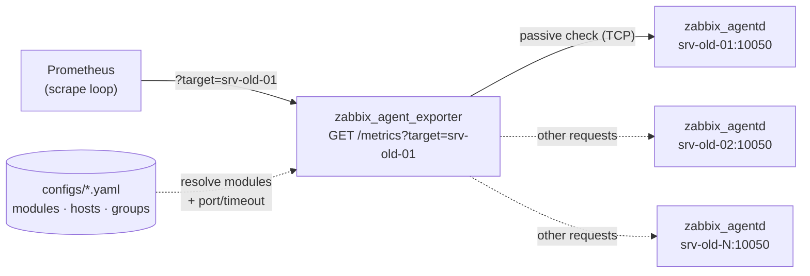
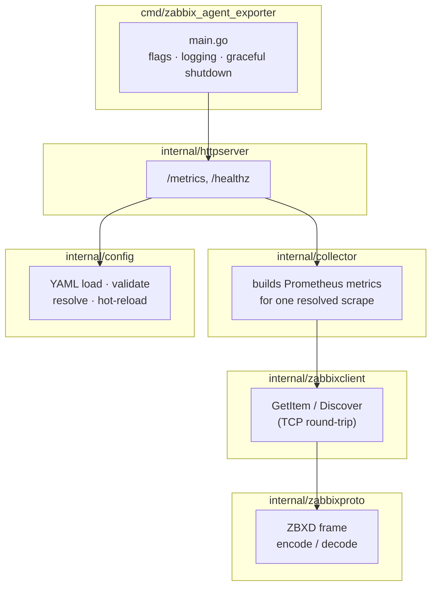

# Zabbix Agent Proxy Exporter

Prometheus exporter that proxies scrapes to legacy [Zabbix passive agents](https://www.zabbix.com/download_agents).
It lets a fleet of old Zabbix agents (on hosts where `node_exporter` isn't
available, like aix/hpux/solaris) be monitored by Prometheus without running a Zabbix server.

## Architecture

This exporter follows the same "multi-target proxy" pattern as
`blackbox_exporter` / `snmp_exporter`: a single long-running binary, not one
process per host. Prometheus tells the exporter *which* host to scrape via
a `target` query parameter on every scrape request — the exporter does not
maintain its own list of targets or poll anything in the background.

For each incoming `GET /metrics?target=...` request:

1. The exporter resolves the target's configuration (which Zabbix modules
   to query, which port/timeout to use) from the YAML config file.
2. It opens a plain TCP connection to the Zabbix agent (`zabbix_agentd`) on
   that host, using the **passive check** protocol — the same protocol a
   real Zabbix server uses to poll an agent. One connection per item
   queried, sequentially, matching how a Zabbix agent actually expects to
   be talked to.
3. Each configured item key (e.g. `agent.ping`, `system.cpu.load[,avg1]`)
   is requested and the returned value is converted into a Prometheus
   metric.
4. For "discovered" items (filesystems, network interfaces, ...), the
   exporter first calls a Zabbix **Low-Level Discovery (LLD)** key (e.g.
   `vfs.fs.discovery`), gets back a JSON list of entities, and then queries
   one item per discovered entity (e.g. free space for each mounted
   filesystem), emitting one labeled Prometheus series per entity.
5. The results are assembled into a fresh, request-scoped
   `prometheus.Registry` and served back as the HTTP response.

No state is kept between requests and nothing is cached: every scrape is a
live round-trip to the real Zabbix agent. This means the exporter's own
load scales with how often and how many hosts Prometheus scrapes, not with
the number of hosts configured.



Internally, the code is split by responsibility:



## Build

    go build -o bin/zabbix_agent_exporter ./cmd/zabbix_agent_exporter

## Run

    ./bin/zabbix_agent_exporter -config configs/config.example.yaml

## Configuring the Zabbix agent to allow scraping

The exporter talks to `zabbix_agentd` exactly like a Zabbix server does, in
**passive check** mode. No special setup is needed on the Zabbix agent side
beyond what a normal Zabbix deployment already requires — you just need to
make sure the exporter's host is allowed to query it. On the monitored host,
in `zabbix_agentd.conf` (or `zabbix_agent2.conf`):

```ini
# Listen on the default passive-check port (must match `defaults.port` /
# the per-host override in the exporter's config.yaml)
ListenPort=10050

# Allow the exporter's host (replace with its real IP/hostname) to query
# this agent. This is the only setting that usually needs changing if the
# agent already worked with a real Zabbix server before.
Server=10.0.0.5

# Passive checks must be enabled (this is the default) — do not set
# StartAgents=0 unless you only need active checks, which this exporter
# does not use.
```

After editing, restart the agent:

    systemctl restart zabbix-agent

No new item keys or UserParameters are required for the items shipped in
`configs/config.example.yaml` (`agent.ping`, `system.cpu.load`,
`vfs.fs.discovery`, ...) — they are all built into the standard Zabbix
agent. If you reference a custom `UserParameter` key in your own module
config, it must be defined in the agent's config file as it would be for a
real Zabbix server.

**Firewall:** make sure TCP port 10050 (or whatever port you configured) is
reachable from the exporter's host to each monitored host — this is the
same rule a real Zabbix server would need.

## Using it from Prometheus

Because this exporter is a *proxy* (like `blackbox_exporter`), Prometheus
scrape configs need `relabel_configs` to turn each configured target into
a `?target=` query parameter against the exporter's own address, instead
of scraping the host directly:

```yaml
scrape_configs:
  - job_name: zabbix
    static_configs:
      - targets:
          - srv-old-01
          - srv-old-02
          - srv-old-03
    relabel_configs:
      # The static target (e.g. "srv-old-01") becomes the ?target= value...
      - source_labels: [__address__]
        target_label: __param_target
      # ...and __address__ is then rewritten to point at the exporter itself.
      - target_label: __address__
        replacement: zabbix-exporter.internal:9290
      # Optional: keep the original hostname as the "instance" label on
      # the resulting metrics, instead of the exporter's own address.
      - source_labels: [__param_target]
        target_label: instance
```

To force a specific module (or combination of modules) for some targets
from Prometheus instead of relying on `groups` in the exporter's config,
add another relabel step setting `__param_module`:

```yaml
    relabel_configs:
      - source_labels: [__address__]
        target_label: __param_target
      - target_label: __param_module
        replacement: linux
      - target_label: __address__
        replacement: zabbix-exporter.internal:9290
```

`__param_module` can only carry one value per relabel rule; to request
multiple modules for the same target from Prometheus, repeat the query
parameter manually with a static scrape target that already includes it,
e.g. `__address__: zabbix-exporter.internal:9290` and
`__metrics_path__: /metrics` with `params: { module: [linux, mysql] }` in
the scrape config — or, simpler, just let the exporter's own `groups`
config resolve the modules (see below), which is the normal path.

## Configuring hosts

The `hosts` section declares per-host overrides of the Zabbix agent port
and/or timeout. A host does **not** need an entry here to be scraped — if
omitted, it simply uses `defaults.port` / `defaults.timeout`. An empty
override (`{}`) means the same thing explicitly.

```yaml
defaults:
  port: 10050
  timeout: 5s

hosts:
  srv-old-01: {}                # no override, uses defaults (port 10050, 5s)
  srv-old-02:
    port: 10150                 # this one agent listens on a different port
    timeout: 10s                # ...and is slower to respond
```

Resolution order for port/timeout, each resolved independently (you can
override just the port and still inherit the default timeout, for
example): `defaults` → `hosts.<name>` override → `?port=`/`?timeout=` URL
query parameter (highest priority, if present).

## Configuring modules

A **module** is a named, reusable set of Zabbix item → Prometheus metric
mappings. Define as many as you need (e.g. `linux`, `windows`, `mysql`) —
a module itself doesn't reference any host; it's just a template.

```yaml
modules:
  linux:
    items:
      - key: "agent.ping"                     # the Zabbix item key to query
        metric: "zabbix_agent_ping"           # the resulting Prometheus metric name
        type: gauge                            # "gauge" or "counter"
        help: "Agent reachability (1=up)"     # Prometheus HELP text
      - key: "system.cpu.load[,avg1]"
        metric: "zabbix_cpu_load1"
        type: gauge
        help: "CPU load average 1m"
    discovered_items:
      - discovery_key: "vfs.fs.discovery"            # Zabbix LLD rule to enumerate entities
        value_key: "vfs.fs.size[{#FSNAME},pfree]"     # item key, with the macro to substitute
        metric: "zabbix_fs_free_percent"
        type: gauge
        help: "Free space percent per filesystem"
        label_name: "mountpoint"                       # Prometheus label name for this series
        label_field: "{#FSNAME}"                       # which LLD macro's value fills that label

  mysql:
    items:
      - key: "mysql.ping"
        metric: "zabbix_mysql_ping"
        type: gauge
        help: "MySQL reachability"
```

- `items`: a simple 1:1 mapping — one Zabbix key, one Prometheus series, no
  labels.
- `discovered_items`: for anything that varies per host (filesystems,
  network interfaces, processes, ...) and would otherwise need a hardcoded
  list of mount points, interface names, etc. per host. See
  [Low-Level Discovery (LLD)](#low-level-discovery-lld) below for how this
  works and how to add a new discovered item.
- `type` must be `gauge` or `counter` — anything else is rejected at
  config-load time.

## Low-Level Discovery (LLD)

Low-Level Discovery is a standard Zabbix agent feature: certain item keys
(the "discovery rules", conventionally ending in `.discovery`) don't return
a single value — they return a JSON array describing every instance of
something the agent can see right now (every mounted filesystem, every
network interface, every running process matching a pattern, ...). This is
how a real Zabbix server auto-creates one item per disk/interface without
an administrator hardcoding paths or interface names per host; this
exporter uses the exact same mechanism.

For example, querying `vfs.fs.discovery` against a real Linux agent returns
something like:

```json
[
  {"{#FSNAME}": "/",    "{#FSTYPE}": "ext4"},
  {"{#FSNAME}": "/var", "{#FSTYPE}": "ext4"},
  {"{#FSNAME}": "/home","{#FSTYPE}": "xfs"}
]
```

Each element is a set of `{#MACRO}` → value pairs for one discovered
entity. A `discovered_items` entry in a module config tells the exporter
how to turn that list into Prometheus metrics:

```yaml
discovered_items:
  - discovery_key: "vfs.fs.discovery"            # 1. call this to list entities
    value_key: "vfs.fs.size[{#FSNAME},pfree]"     # 2. query this per entity
    metric: "zabbix_fs_free_percent"
    type: gauge
    help: "Free space percent per filesystem"
    label_name: "mountpoint"                       # 3. label the result with...
    label_field: "{#FSNAME}"                       # ...this macro's value
```

What the exporter actually does with this, per scrape:

1. Calls `discovery_key` (`vfs.fs.discovery`) once — gets back the JSON
   array shown above.
2. For each element, reads the macro named by `label_field` (`{#FSNAME}`)
   — e.g. `/`, then `/var`, then `/home`.
3. Builds the real item key by substituting that value into `value_key`
   wherever `label_field`'s macro appears — `vfs.fs.size[{#FSNAME},pfree]`
   becomes `vfs.fs.size[/,pfree]`, then `vfs.fs.size[/var,pfree]`, etc. —
   and queries each one individually against the agent.
4. Emits one Prometheus series per entity, named `metric`, with the label
   `label_name` set to the value used in step 2:

   ```
   zabbix_fs_free_percent{mountpoint="/"} 42.5
   zabbix_fs_free_percent{mountpoint="/var"} 17.25
   zabbix_fs_free_percent{mountpoint="/home"} 63.0
   ```

Because the entity list is fetched live on every scrape rather than
configured statically, a new disk or network interface that appears on a
host shows up in Prometheus automatically on the next scrape — nothing to
edit in `config.yaml` when the underlying host changes.

Other common Zabbix LLD rules you can use the same way: `net.if.discovery`
(network interfaces, macro `{#IFNAME}`), `vfs.fs.discovery` (filesystems,
macro `{#FSNAME}`/`{#FSTYPE}`), or any custom discovery rule exposed by a
`UserParameter` script, as long as it returns the standard Zabbix LLD JSON
shape (an array of `{#MACRO}`-keyed objects).

If `discovery_key` returns `ZBX_NOTSUPPORTED` (e.g. the rule doesn't exist
on that particular agent/OS) or an entity's `value_key` query fails, that
one discovered item is skipped (logged + counted in
`zabbix_item_errors_total`) without failing the rest of the scrape — see
[Meta-metrics](#meta-metrics).

## Assigning modules to hosts (groups)

**Groups** are what actually connects hosts to modules. A group lists some
hosts and some modules; every host in the list gets every module in the
list. A host can appear in multiple groups — in that case it gets the
**union** of modules from every group it belongs to (no duplicates):

```yaml
groups:
  - name: "tous-linux"
    hosts: ["srv-old-01", "srv-old-02", "srv-old-03"]
    modules: ["linux"]

  - name: "bases-de-donnees"
    hosts: ["srv-old-02"]        # srv-old-02 is also in "tous-linux" above
    modules: ["mysql"]
```

With the config above, scraping `srv-old-02` with no `?module=` query
parameter resolves to **both** `linux` and `mysql` (the union). Scraping
`srv-old-01` resolves to just `linux`.

Notes:
- Hosts listed in a group's `hosts` do **not** need a matching entry under
  the top-level `hosts:` section — that section is only for port/timeout
  overrides. A host can be group-only.
- If a request's `?module=` query parameter is present, it **replaces**
  the group-derived modules entirely for that one request (it does not
  add to them), and every module named must exist in `modules:` — an
  unknown module name is rejected with a `400` rather than silently
  ignored.
- If a target matches no group and no `?module=` is given, the exporter
  returns `400 Bad Request` ("no module resolved for target ...") rather
  than silently returning an empty scrape.

## Configuration hot-reload

The config file is watched on disk (directory-level watch, so it also
works with editors/tools that save by writing a temp file and renaming it
into place, not just in-place writes) and reloaded automatically — no
restart, no signal needed.

- A successful reload replaces the in-memory config atomically; any scrape
  already in flight keeps using the config snapshot it started with.
- If the new file fails to parse or fails validation (unknown YAML key,
  invalid item `type`, a group referencing an unknown module, duplicate
  group names, ...), the reload is **rejected** and logged as an error —
  the exporter keeps serving with the last known-good config rather than
  crashing or serving a broken one.
- A single save can trigger more than one reload attempt in quick
  succession (e.g. an editor that writes then renames); a transient error
  from an intermediate, partially-written state is expected and is not a
  sign of a real problem as long as it's followed by a successful reload
  of the final content.

In short: edit `configs/config.example.yaml` (or whatever `-config` points
to) and save — new/changed hosts, modules, and groups take effect on the
next scrape, with no downtime.

## Endpoints

- `GET /metrics?target=<host>[&module=<name>]*[&port=<p>][&timeout=<d>]`
  — scrape one host. `target` is required. `module` may be repeated to
  request specific modules (replacing the group-derived ones); `port`/
  `timeout` override the resolved connection settings for this one
  request only.
- `GET /healthz` — always `200 OK` if the process is alive.

## Meta-metrics

Every scrape response also includes, regardless of which modules were
queried:

- `zabbix_scrape_success` (gauge, 0 or 1) — `0` only if the agent could
  not be reached at all (the very first query failed); still `1` if the
  agent responded but some individual items were unsupported.
- `zabbix_scrape_duration_seconds` (gauge) — how long the whole scrape
  took.
- `zabbix_item_errors_total{item="..."}` (counter) — one series per item
  key that failed during this scrape, with its failure count.

## License

GPLv3 — see [LICENSE](LICENSE).

Copyright (C) 2026 Mathieu Carbonneaux, with Claude (Anthropic) as co-author.
