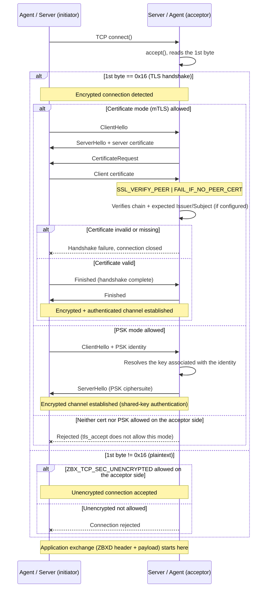
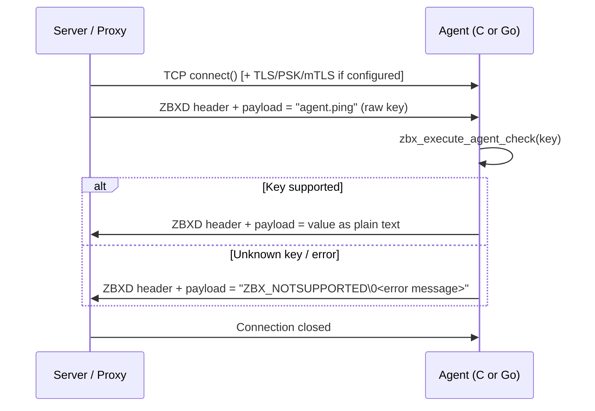
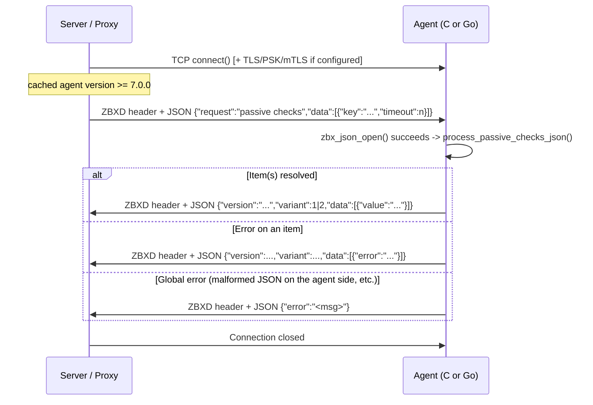
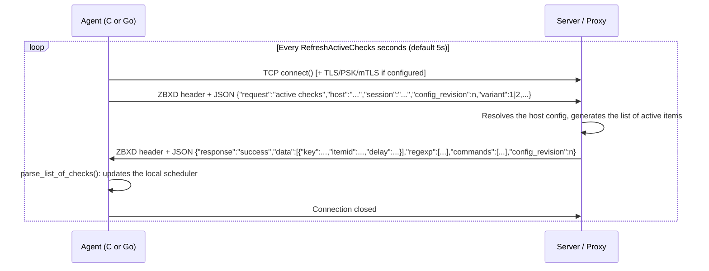
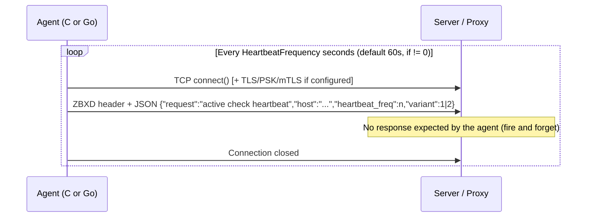

# Spec: network protocol between Zabbix server/proxy and agents (passive / active)

- Date: 2026-11-12
- Scope: exchanges between `zabbix_server` / `zabbix_proxy` ↔ C agent `zabbix_agentd` and the Go agent2 (`src/go/...`)
- Code base analyzed: this repository, Zabbix **8.2.0 alpha1** (`include/version.h`) with claude.ai
- Out of scope: the proxy ↔ central server protocol (config sync, "proxy data") — reuses the same ZBXD header but with different payloads, not covered here.

> **Methodological note**: every claim in this spec is either (a) **verified in the code** of this repository, with a `file:line` reference, or (b) a **known public historical reference point** about Zabbix's evolution, explicitly marked `[not verified in this repo]`. Do not conflate the two categories.

---

## 1. Overview

The Zabbix agent protocol is a **binary TCP protocol with a textual payload**, used for two symmetric roles:

- **Passive mode**: the server (or proxy) initiates the connection to the agent, which listens on port 10050. The server asks for an item's value, the agent replies.
- **Active mode**: the agent initiates the connection to the server/proxy (port 10051). The agent periodically fetches its list of items to monitor, then sends the collected values on its own initiative, without waiting for a request.

Both modes share the same low-level framing (the `ZBXD` header, section 2) and can be protected by the same transport security layer (TLS/PSK/mTLS, section 3). On top of this common framing, two payload families coexist for backward-compatibility reasons:

- **plain-text** payload (an item key or a value, unstructured) — the historical behavior,
- **structured JSON** payload — introduced progressively, generalized since version 7.0 for passive mode, used for longer in active mode.

Two agent implementations exist in this repository and speak the same network protocol, with minor implementation differences noted throughout this document:

| | C agent (`zabbix_agentd`) | Agent2 (Go) |
|---|---|---|
| Code | `src/zabbix_agent/` | `src/go/internal/agent/`, `src/go/pkg/zbxcomms/` |
| JSON field `"variant"` | `1` | `2` |
| "Large" header support (21 bytes) | Yes | No |

---

## 2. Transport format: the `ZBXD` header

### 2.1 Byte layout

Every message (request or response, passive or active) is preceded by a fixed header starting with the `"ZBXD"` magic:

**Standard** format (13 bytes total, 4+1+4+4):
```
Offset  Size        Content
0       4 bytes     "ZBXD" (magic, ASCII)
4       1 byte      flags (see 2.2)
5       4 bytes     datalen  (data length, little-endian)
9       4 bytes     origlen  (decompressed length if compressed, otherwise 0)
```

**"Large"** format (flag `ZBX_TCP_LARGE` set, 21 bytes total, 4+1+8+8):
```
Offset  Size        Content
0       4 bytes     "ZBXD" (magic, ASCII)
4       1 byte      flags (see 2.2)
5       8 bytes     datalen  (data length, little-endian)
13      8 bytes     origlen  (decompressed length if compressed, otherwise 0)
```

The "large" format corresponds to `ZBX_MAX_HEADER_LEN` (`include/zbxcommshigh.h:240`).

Code references (C agent):
- Magic and magic length: `src/libs/zbxcomms/comms.c:972-973`
- Header construction on send: `src/libs/zbxcomms/comms.c:1040-1071` (`zbx_tcp_send_context_init`)
- Parsing on receive (state machine): `src/libs/zbxcomms/comms.c:2222-2526` (`zbx_tcp_recv_context`), with magic verification at `comms.c:2292-2303` and flag/length reading at `comms.c:2316-2360`

On the Go agent2 side, only the standard format (13 bytes) is implemented:
- Constants: `src/go/pkg/zbxcomms/comms.go:38-40`
```go
const headerSize = 4 + 1 + 4 + 4
const tcpProtocol = byte(0x01)
const zlibCompress = byte(0x02)
```
- Write: `comms.go:114-144` — Read: `comms.go:160-260`
- Example frame verified by the tests (`src/go/pkg/zbxcomms/comms_test.go:36`):
  ```
  "ZBXD\x01\x0A\x00\x00\x00\x00\x00\x00\x00agent.ping"
  ```
  i.e.: magic `ZBXD`, flag `0x01` (protocol), `datalen=10` (LE, 4 bytes), `origlen=0`, followed by the 10 bytes `agent.ping`.

### 2.2 Flags table

Defined in `include/zbxcommshigh.h:276-278`:

| Flag | Value | Meaning |
|---|---|---|
| `ZBX_TCP_PROTOCOL` | `0x01` | Zabbix protocol marker — always present |
| `ZBX_TCP_COMPRESS` | `0x02` | Data is compressed (zlib); `origlen` carries the decompressed size |
| `ZBX_TCP_LARGE` | `0x04` | "Large" header: `datalen`/`origlen` on 8 bytes instead of 4 |

On receive, the code checks that the flag byte contains at least `ZBX_TCP_PROTOCOL` and does not exceed the set of known flags (`comms.c:2318-2323`).

### 2.3 Compression

If `ZBX_TCP_COMPRESS` is set, the data bytes are zlib-compressed; `origlen` carries the size once decompressed. Decompression on the C side: `src/libs/zbxcomms/comms.c:2420-2464` (`zbx_uncompress`). A comment in `zbx_tcp_send_context` (`comms.c:1081-1101`) notes that the header, length, and data are grouped into a single block ≤ 16384 bytes to limit TLS fragmentation (explicit reference to RFC 5246).

High-level send macros default to `ZBX_TCP_PROTOCOL` (`zbxcommshigh.h:289-293`); the proxy response always uses `ZBX_TCP_PROTOCOL | ZBX_TCP_COMPRESS` (`zbxcommshigh.h:41-42`).

### 2.4 Size limits

Defined in `include/zbxcommon.h:574-583`:

| Constant | Value | Scope |
|---|---|---|
| `ZBX_MAX_RECV_DATA_SIZE` | 1 GiB | Max size in standard format |
| `ZBX_MAX_RECV_LARGE_DATA_SIZE` | 16 GiB (1 GiB on Windows) | Max size in "large" format |
| `ZBX_MAX_PASSIVE_CHECK_DATA_SIZE` | 8 MiB | Max size specific to passive checks |

---

## 3. Transport security: TLS / PSK / mTLS

### 3.1 The three modes

Defined in `include/zbxcommshigh.h:280-285`:

| Mode | Constant | Value | Config text |
|---|---|---|---|
| Unencrypted | `ZBX_TCP_SEC_UNENCRYPTED` | 1 | `"unencrypted"` |
| PSK (pre-shared key) | `ZBX_TCP_SEC_TLS_PSK` | 2 | `"psk"` |
| Certificate (mTLS) | `ZBX_TCP_SEC_TLS_CERT` | 4 | `"cert"` |

These modes are configured independently on send (`TLSConnect`) and on accept (`TLSAccept`), and can be combined on the accepting side (e.g. accepting either PSK or cert).

### 3.2 Automatic plaintext/TLS detection

There is **no explicit application-level negotiation** of encryption: when accepting a connection, the first byte received is inspected. If it is `0x16` (the "Handshake" record type byte of a TLS record), the connection is treated as TLS; otherwise it is treated as plaintext.

Reference: `src/libs/zbxcomms/comms.c:1887-1888`:
```c
/* if the 1st byte is 0x16 then assume it's a TLS connection */
if (1 == res && '\x16' == buf)
```
Branches to `zbx_tls_accept` (`comms.c:1895`) if the `tls_accept` configuration allows `ZBX_TCP_SEC_TLS_CERT|ZBX_TCP_SEC_TLS_PSK` (`comms.c:1891`); rejected if encryption is detected but not allowed, or if the connection is plaintext but `ZBX_TCP_SEC_UNENCRYPTED` is not allowed (`comms.c:1917`).

### 3.3 Mutual certificate authentication (mTLS)

When certificate mode is used, the server requires a client certificate and validates it — this is not a simple one-way encryption layer, it is genuine **mutual** authentication:

```c
// src/libs/zbxcomms/tls_openssl.c:986
SSL_CTX_set_verify(ctx_cert, SSL_VERIFY_PEER | SSL_VERIFY_FAIL_IF_NO_PEER_CERT, NULL);
```

In addition to standard certificate chain validation, Zabbix allows restricting acceptance to an expected peer certificate Issuer and/or Subject (e.g. to require a certificate issued by a specific internal CA). Implemented in `src/libs/zbxcomms/tls_openssl.c:1569-1573` (parameters `tls_arg1`/`tls_arg2` = required issuer/subject) and checked at connection-acceptance points (`tls_openssl.c:1778-1790`, `tls_openssl.c:2051-2054`). The peer certificate is also logged at debug level (`tls_openssl.c:630-660`).

PSK mode (`ZBX_TCP_SEC_TLS_PSK`) offers a lighter form of mutual authentication: both parties share a symmetric key identified by a "PSK identity", without a certificate infrastructure.

### 3.4 Sequence diagram — transport negotiation



---

## 4. Passive mode

In this mode, the **server (or proxy) is the TCP client**: it connects to the agent (port 10050 by default), sends a request, reads a response, closes the connection. Two request/response formats coexist.

### 4.1 Plain-text format (legacy, pre-7.0)

The request payload is **the item key as-is**, with no JSON envelope (e.g. `agent.ping`, `system.cpu.load[,avg1]`). The agent replies either with the value in plain text, or with a `ZBX_NOTSUPPORTED` error.

C agent code: `src/zabbix_agent/listener/listener.c:153-223` (`process_listener`):
- if the payload is not valid JSON → handled directly as a key by `zbx_execute_agent_check` (`listener.c:179`)
- normal response: `zbx_tcp_send_to(s, *value, ...)` (`listener.c:185`)
- error response: concatenates `ZBX_NOTSUPPORTED` + a null byte + the error message (`listener.c:198-208`)

Constants (`include/zbxcommon.h:264,268`):
```c
#define ZBX_NOTSUPPORTED      "ZBX_NOTSUPPORTED"
#define ZBX_NOTSUPPORTED_MSG  "Unknown error."
```

Equivalent Go agent2 code: `src/go/internal/agent/serverlistener/passivecheck.go`, function `processPlainTextRequest` (lines 184-202), error formatted identically in `formatError` (lines 30-39).

The **server** decides to use this plain-text format when the agent version it has cached (per interface) is older than 7.0.0 — see section 6.

#### Diagram — passive, plain text



### 4.2 JSON format (≥ 7.0)

Request built on the server side by `zbx_agent_prepare_request` (`src/libs/zbxagentget/agent_get.c:36-45`):

```json
{
  "request": "passive checks",
  "data": [
    {"key": "<key>", "timeout": <n>}
  ]
}
```

Handled on the C agent side by `process_passive_checks_json` (`listener.c:39-151`). Response built in the same function (`listener.c:50-141`):

```json
{"version": "<ver>", "variant": 1, "data": [{"value": "<val>"}]}
```

On a per-item error:
```json
{"version": "<ver>", "variant": 1, "data": [{"error": "<msg>"}]}
```

On a global parsing error (root-level):
```json
{"error": "<msg>"}
```
(`listener.c:138-141`)

Equivalent Go agent2 code: `src/go/internal/agent/serverlistener/passivecheck.go`:
- request (struct `passiveChecksRequest`, lines 67-99): same fields
- success response (`formatJSONCheckDataPayload`, lines 101-128): `{"version":"...","variant":2,"data":[{"value":"..."}]}`
- error response (`formatCheckErrorPayload`, lines 130-161): `{"version":...,"variant":...,"data":[{"error":"..."}]}`

The `"variant"` field distinguishes the C agent (`1`) from the Go agent2 (`2`) — constants `ZBX_PROGRAM_VARIANT_AGENT`/`ZBX_PROGRAM_VARIANT_AGENT2` in `include/zbxcommon.h:283-284`.

#### Diagram — passive, JSON (≥ 7.0)



---

## 5. Active mode

In this mode, the **agent is the TCP client**: it periodically initiates connections to the server/proxy (port 10051 by default), without waiting to be asked.

### 5.1 Active checks list request

Built by `refresh_active_checks` (`src/zabbix_agent/active_checks/active_checks.c:882-1007`), lines 897-944:

```json
{
  "request": "active checks",
  "host": "<hostname>",
  "host_metadata": "...",
  "interface": "...",
  "ip": "...",
  "port": <n>,
  "config_revision": <n>,
  "session": "<token>",
  "version": "<ZABBIX_VERSION>",
  "variant": 1
}
```
(`host_metadata`, `interface`, `ip`, `port` are optional; `port` is only sent if it differs from 10050.)

Go equivalent: struct `activeChecksRequest`, `src/go/internal/agent/serverconnector/serverconnector.go:64-75,102-153`, same fields, `"variant":2`.

### 5.2 Server response: list of active items

Parsed by `parse_list_of_checks` (`active_checks.c:447-715`), expected format (comment at line 556-557):

```json
{
  "data": [
    {"key": "system.cpu.num", "itemid": <n>, "delay": "<n>", "lastlogsize": <n>, "mtime": <n>, "timeout": "<n>"},
    ...
  ],
  "response": "success",
  "config_revision": <n>,
  "upload": "enabled",
  "regexp": [ ... ],
  "commands": [ {"command": "...", "id": <n>, "wait": <0|1>, "timeout": "<n>"}, ... ]
}
```

`regexp[]` (global regular expressions, lines 648-703) and `commands[]` (remote commands, `parse_list_of_commands`, lines 717-808) are extensions of the same response.

Go equivalent (struct `activeChecksResponse`, `serverconnector.go:77-85`):
```go
type activeChecksResponse struct {
    Response       string
    Info           string
    ConfigRevision uint64
    Data           []*scheduler.Request   // key, itemid, delay, lastlogsize, mtime
    Commands       []*agent.RemoteCommand
    Expressions    []*glexpr.Expression
    HistoryUpload  string
}
```

#### Diagram — active, fetching the checks list



### 5.3 Sending collected results ("agent data")

Each result is formatted by `format_metric_results` (`active_checks.c:1053-1127`):

```json
{
  "itemid": <n>, "value": "...", "state": <if notsupported>,
  "lastlogsize": <n>, "mtime": <n>,
  "timestamp": <n>, "source": "...", "severity": <n>, "eventid": <n>, "id": <n>,
  "clock": <sec>, "ns": <ns>
}
```

Outer envelope built by `send_buffer` (`active_checks.c:1245-1284`):

```json
{
  "request": "agent data",
  "session": "<token>",
  "version": "<ZABBIX_VERSION>",
  "variant": 1,
  "host": "<hostname>",
  "data": [ ... ],
  "commands": [ ... ]
}
```

The connection timestamp (reference `clock`/`ns`) is injected separately via the `connect_callback` callback (`active_checks.c:1209-1221`), at handshake time, not inside each `data` element.

On the Go side, the equivalent response struct is `agentDataResponse` (`serverconnector.go:87-91`); the construction of the send envelope lives in the result-cache code (not detailed here, identical JSON structure on the wire).

### 5.4 Server response to "agent data"

Verified by `check_response` (`active_checks.c:1021-1051`): requires `"response":"success"` (`ZBX_PROTO_VALUE_SUCCESS`, `include/zbxjson.h:246`), reads `info` (optional) and `upload` (`ZBX_PROTO_TAG_HISTORY_UPLOAD`, `zbxjson.h:175`).

```json
{"response": "success", "info": "processed: 3; failed: 0; total: 3; seconds spent: 0.000123", "upload": "enabled"}
```

On the Go side: struct `agentDataResponse` (fields `Response`, `Info`, `HistoryUpload`), explicit comparison `response.Response != "success"` (`serverconnector.go:200`).

#### Diagram — active, sending results

```mermaid
sequenceDiagram
    participant Ag as Agent (C or Go)
    participant S as Server / Proxy

    Note over Ag: Items collected locally, buffered
    Ag->>S: TCP connect() [+ TLS/PSK/mTLS if configured]
    Ag->>S: ZBXD header + JSON {"request":"agent data","session":"...","host":"...","variant":1|2,"data":[{"itemid":n,"value":"...","clock":t,"ns":ns},...]}
    S->>S: Validates the session, inserts the values into the database
    alt Processing OK
        S->>Ag: ZBXD header + JSON {"response":"success","info":"processed: N; failed: 0; ...","upload":"enabled"}
        Ag->>Ag: check_response() OK -> clears the sent buffer
    else Server error
        S->>Ag: ZBXD header + JSON {"response":"failed","info":"<message>"}
        Ag->>Ag: check_response() fails -> keeps the buffer for retry
    end
    Ag->>S: Connection closed
```

### 5.5 Heartbeat (active agent "liveness")

Sent by `send_heartbeat_msg` (`active_checks.c:1884-1926`):

```json
{
  "request": "active check heartbeat",
  "host": "<hostname>",
  "heartbeat_freq": <n>,
  "version": "<ZABBIX_VERSION>",
  "variant": 1
}
```

No response is parsed (receive callbacks are NULL, `active_checks.c:1904-1905`): this is a "fire and forget" message on the agent side. Triggered in the main loop (`active_checks_thread`, `active_checks.c:1968-1999`) if `HeartbeatFrequency != 0`.

Go equivalent: `sendHeartbeatMsg` (`serverconnector.go:346-386`), struct `heartbeatMessage` (lines 93-99), same fields + `"variant":2`.

> Note: there is **no** separate "host/interface availability" message sent by the active agent itself. The tags `ZBX_PROTO_TAG_INTERFACE_AVAILABILITY`/`ZBX_PROTO_TAG_AVAILABLE` (`zbxjson.h:58,64`) relate to interface availability managed on the server/proxy side (pollers), not a message sent by the agent. The only "liveness" signal emitted by the active agent is this heartbeat.

#### Diagram — active, heartbeat



### 5.6 Configuration parameters (C agent)

In `src/zabbix_agent/zabbix_agentd.c`:

| Parameter | Default | Reference |
|---|---|---|
| `RefreshActiveChecks` | 5 s | `zabbix_agentd.c:47`, option declared at line 985 |
| `HeartbeatFrequency` | 60 s (max 3600 s = `ZBX_AGENT_HEARTBEAT_FREQUENCY_MAX`, `include/zbxcfg.h:43`) | `zabbix_agentd.c:88`, option declared at lines 1060-1061 |

---

## 6. Protocol version evolution

### 6.1 Verified in this repository

- Version encoding: `ZBX_COMPONENT_VERSION(major,minor,patch)` (`include/zbxversion.h:20-27`), packed into 3 bytes `(major<<16)|(minor<<8)|patch`.
- **Plain-text / JSON switch threshold in passive mode**: the server chooses which format to send based on the agent version it has cached for the given interface:
  ```c
  // src/libs/zbxpoller/checks_agent.c:46-108 (zbx_agent_get_value)
  if (ZBX_COMPONENT_VERSION(7, 0, 0) <= *version)
      zbx_agent_prepare_request(&j, item->key, item->timeout);  // JSON
  else
      ptr = item->key, len = strlen(item->key);                  // plain text
  ```
  The agent version is cached per interface in `src/libs/zbxcacheconfig/dbconfig.c` (lines 2520-2522, 9424, 14397-14398) and re-evaluated on every exchange (response parsing in `src/libs/zbxagentget/agent_get.c:23-161`).
- **Implementation distinction**: JSON field `"variant"` (1 = C agent, 2 = Go agent2), constants `include/zbxcommon.h:283-284`. Present in every JSON request/response described above.
- **"Large" header support** (21 bytes, flag `ZBX_TCP_LARGE`): implemented on the C side (`comms.c`), absent on the Go agent2 side (`zbxcomms/comms.go` only handles the fixed 13-byte header).
- There is **no** version negotiation at the TLS/application handshake level for the agent protocol (unlike the proxy↔server pair, which has its own `zbx_check_protocol_version` mechanism, `src/libs/zbxdbwrap/proxy.c:3113`, used in `src/zabbix_server/trapper/proxydata.c:172` — out of scope for this spec).

### 6.2 Known public historical reference points `[not verified in this repo]`

These items reflect general public knowledge of Zabbix's history and have not been re-verified against the code in this checkout; they are included to situate the protocol's evolution in time:

- The `"ZBXD"` + length framing has existed since the early 1.x versions of the agent protocol — well before JSON was introduced.
- **zlib compression** support (`ZBX_TCP_COMPRESS` flag) was introduced around **version 3.4**, to reduce bandwidth on large payloads (e.g. proxy → server, large "agent data" batches).
- Active mode's **JSON** payload (`"request":"active checks"`, `"agent data"`) has been in place longer than passive mode's move to JSON — passive mode stayed plain-text longer because its structuring needs (per-item timeout, detailed errors) were lower until features like per-item timeout were added.
- Passive mode's switch to a generalized **JSON** format corresponds to version **7.0**, consistent with the `ZBX_COMPONENT_VERSION(7,0,0)` threshold observed in the code (section 6.1) — this point is therefore both a public historical reference point and a fact verified in the code.
- **PSK** encryption support was introduced in version **3.0**; **certificate (mTLS)** authentication support followed shortly after, in the same 3.0 branch.

---

## 7. Appendix

### 7.1 Relevant JSON constants (`include/zbxjson.h`)

```c
#define ZBX_PROTO_TAG_REQUEST                  "request"                  // line 49
#define ZBX_PROTO_TAG_VARIANT                  "variant"                  // line 222
#define ZBX_PROTO_TAG_HEARTBEAT_FREQ           "heartbeat_freq"           // line 195
#define ZBX_PROTO_TAG_HISTORY_UPLOAD           "upload"                   // line 175
#define ZBX_PROTO_TAG_INTERFACE_AVAILABILITY   "interface availability"   // line 64
#define ZBX_PROTO_TAG_AVAILABLE                "available"                // line 58
#define ZBX_PROTO_VALUE_SUCCESS                "success"                  // line 246
#define ZBX_PROTO_VALUE_GET_PASSIVE_CHECKS     "passive checks"           // line 248
#define ZBX_PROTO_VALUE_GET_ACTIVE_CHECKS      "active checks"            // line 249
#define ZBX_PROTO_VALUE_AGENT_DATA             "agent data"                // line 253
#define ZBX_PROTO_VALUE_ACTIVE_CHECK_HEARTBEAT "active check heartbeat"   // line 261
```

### 7.2 Size limits (`include/zbxcommon.h`)

| Constant | Value |
|---|---|
| `ZBX_MAX_RECV_DATA_SIZE` | 1 GiB |
| `ZBX_MAX_RECV_LARGE_DATA_SIZE` | 16 GiB (non-Windows) / 1 GiB (Windows) |
| `ZBX_MAX_PASSIVE_CHECK_DATA_SIZE` | 8 MiB |

### 7.3 Reference files

| Component | C agent | Agent2 (Go) |
|---|---|---|
| Framing / TLS | `src/libs/zbxcomms/comms.c`, `tls_openssl.c`, `tls_gnutls.c` | `src/go/pkg/zbxcomms/comms.go` |
| Passive mode | `src/zabbix_agent/listener/listener.c` | `src/go/internal/agent/serverlistener/passivecheck.go` |
| Active mode | `src/zabbix_agent/active_checks/active_checks.c` | `src/go/internal/agent/serverconnector/serverconnector.go` |
| Passive request construction (server) | `src/libs/zbxagentget/agent_get.c` | — |
| Version negotiation (server) | `src/libs/zbxpoller/checks_agent.c` | — |
| Protocol constants | `include/zbxjson.h`, `include/zbxcommshigh.h`, `include/zbxcommon.h`, `include/zbxversion.h` | — |